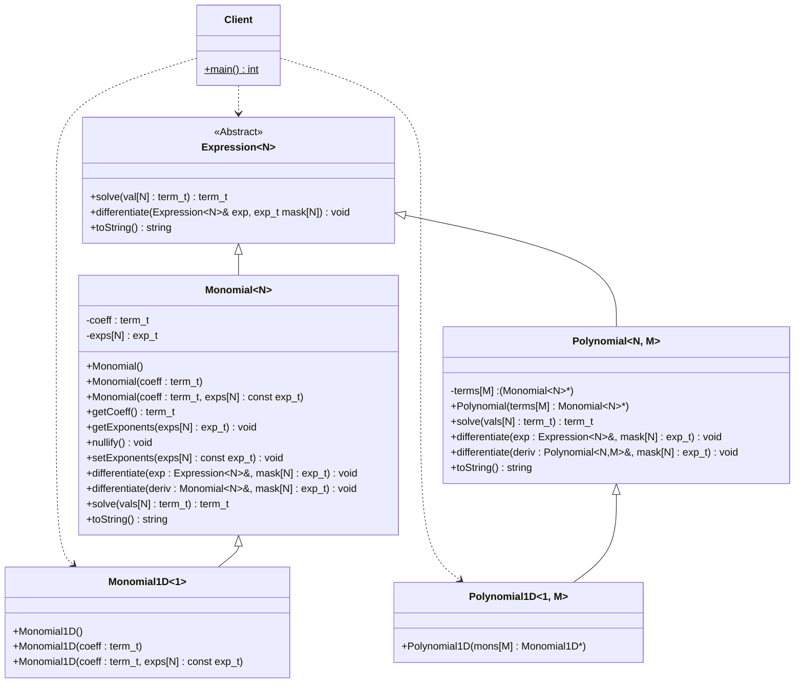

## POO-prosit_5

# Contexte :
Claude Delannoy prépare un chapitre de livre sur l’architecture du code C++ et prend comme exemple une classe de polynômes. Au fil de sa réflection il soulève 4 questions : quelles classes créer, faut-il de l’héritage entre elles, comment concilier objets immuables et classes dérivées sans fuite de mémoire et comment organiser le code avec des namespaces.
# Mot clés :
- Polynômes : Expression mathématique composée d'une somme de monômes, représentée en C++ par une structure ou une classe regroupant une collection de termes.
- Monômes : Terme algébrique individuel (produit d'un coefficient et d'une variable élevée à une puissance), souvent modélisé par une classe élémentaire.
- Coefficient : Valeur numérique multiplicative d'un monôme, typiquement stockée sous forme de type flottant (ex. double ou float) ou entier.
- Variables : Symbole représentant l'inconnue de l'expression polynômiale (ex. x), pouvant être géré sous forme de caractère ou de chaîne. Il peut en avoir plusieurs pour un seul terme.
- Puissance : Exposant auquel la variable est élevée, généralement représenté par un entier positif ou nul (unsigned int).
- Agrégation : Relation "contient un" entre objets où un polynôme contient une liste ou un tableau de monômes sans en posséder obligatoirement le cycle de vie de manière stricte.
- Héritage : Mécanisme permettant à une classe dérivée de réutiliser ou d'étendre les caractéristiques d'une classe de base.
- Immuabilité : Propriété d'un objet dont l'état ne peut plus être modifié après sa création, obligeant la création de nouveaux objets pour chaque opération.
- Object slicing : Phénomène de perte de données d'une classe dérivée lorsqu'un objet est copié ou passé par valeur dans une variable de type classe de base.
- Référence : Alias vers une zone mémoire existante (ex. const Monomial&), permettant de passer des objets efficacement sans copie ni slicing.
- Pointeur : Variable contenant l'adresse mémoire d'un autre objet, essentielle pour le polymorphisme et la gestion dynamique de la mémoire.
- Allocation : Réservation d'un espace mémoire pour stocker des objets, soit sur la pile (stack), soit dynamiquement sur le tas (heap via new/smart pointers).
- Mémoire : Espace de stockage géré explicitement en C++ dont la libération correcte évite les fuites mémoire (memory leaks).
- Namespace : Espace de nommage servant à organiser le code et à éviter les collisions de noms entre différentes bibliothèques ou classes.
- Couplage : Degré de dépendance entre plusieurs classes ou modules ; un couplage faible est recherché pour une architecture modulaire et maintenable.
- Modules : Unité d'organisation logique et physique du code (ex. modules C++20 ou séparation fichiers en-tête / sources).
- Encapsulation : Principe consistant à masquer l'état interne d'un objet et à n'en autoriser l'accès que via des méthodes publiques dédiées (ex. specificateurs private/protected).
- Factorisation : Réorganisation du code visant à regrouper les fonctionnalités communes et éviter la duplication de logique. /// Opération mathématique visant à regrouper les termes de meme types ex: (x² − 1) = (x − 1)(x + 1)). 
# Problématique : 
Comment concevoir et organiser en C++ des classes de polynômes et de monômes qu'on puisse étendre par héritage, en garantissant l'immuabilité des objets sans objet slicing ni fuite mémoire ? 
# Contraintes :
- Monômes immuables et dérivables
- Ne pas utiliser d’héritage entre Polynomial et monomial
- Tout dans le même fichier
- Réaliser des classes rangées dans des namespaces

# Pistes de solutions :
- Définir les mots clés
- Modéliser les polynômes avec deux classes, Monomial et Polynomial, reliées par agrégation.
- Ne pas faire d’héritage entre les deux classes, mais passer par une classe abstraite commune 
- Rendre les objets immuables : chaque opération renvoie un nouvel objet
- Eviter le slicing et les fuites mémoire
# Plan d’actions :
- Récupérer le code sur GitHub
- Analyser le code
- Documenter les éléments (classes, immuabilité, slicing, mémoire)
- Réorganiser le code avec des namespaces
- Tester le code (compilation et opérations sur les polynômes)
# Livrable : 
- Documentation
- Code corrigé et modifié

